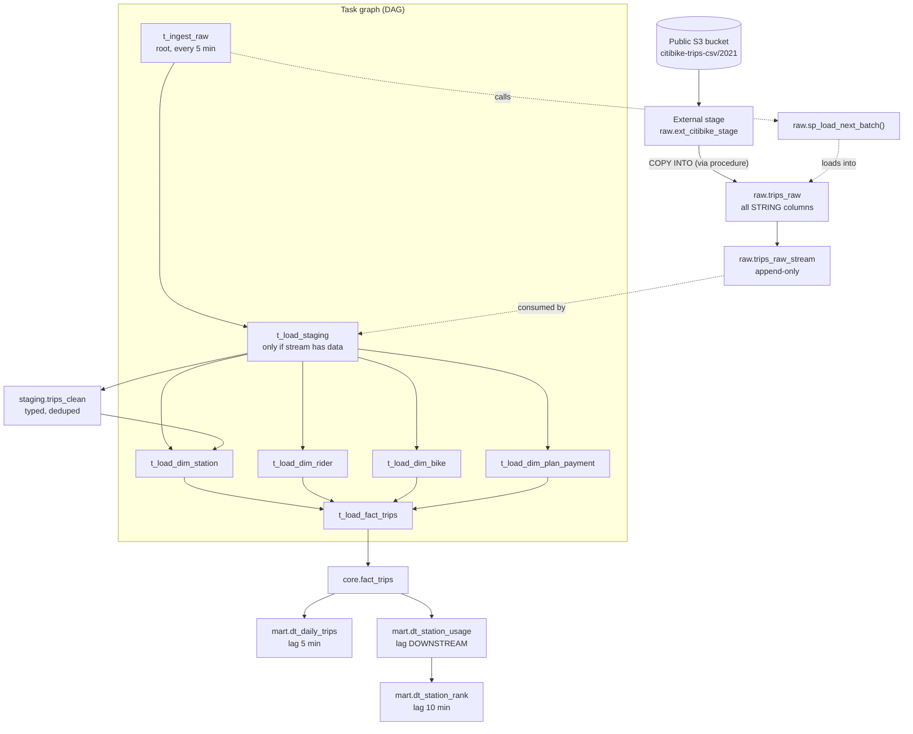
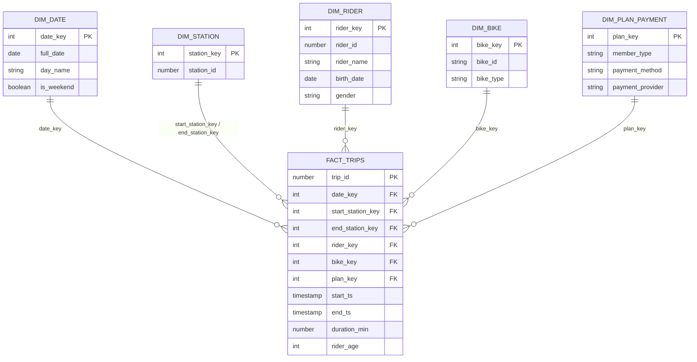

# Snowflake Citi Bike Pipeline

An end-to-end, practice-grade data engineering project on **Snowflake**. It ingests public Citi Bike trip files from an **external S3 stage**, lands them in a raw layer, tracks new rows with a **stream**, transforms them through a **task graph (DAG)** into a **star schema**, and serves analytics through chained **dynamic tables**.

Everything is plain SQL (plus one Snowflake Scripting procedure) and runs in a single worksheet on a free Snowflake trial account. No AWS account or credentials are needed because the source bucket is public.

---

## Table of contents

1. [What this project demonstrates](#1-what-this-project-demonstrates)
2. [Architecture](#2-architecture)
3. [Dataset](#3-dataset)
4. [Repository structure](#4-repository-structure)
5. [Prerequisites](#5-prerequisites)
6. [Quick start](#6-quick-start)
7. [Layer-by-layer walkthrough](#7-layer-by-layer-walkthrough)
8. [Star schema](#8-star-schema)
9. [Task graph and load frequency](#9-task-graph-and-load-frequency)
10. [Dynamic tables](#10-dynamic-tables)
11. [Monitoring and validation](#11-monitoring-and-validation)
12. [Sample analytics queries](#12-sample-analytics-queries)
13. [Design decisions and why](#13-design-decisions-and-why)
14. [Troubleshooting](#14-troubleshooting)
15. [Cost control and cleanup](#15-cost-control-and-cleanup)
16. [Limitations](#16-limitations)
17. [Stretch goals](#17-stretch-goals)
18. [Author](#18-author)

---

## 1. What this project demonstrates

| Snowflake concept | Where it is used |
|---|---|
| External stage and file format | `raw.ext_citibike_stage` reads gzipped CSVs straight from a public S3 bucket |
| `COPY INTO` with transformation | Loads staged files into `raw.trips_raw`, capturing source file name and row number |
| Tables (layered design) | `raw`, `staging`, `core` (star schema) and `mart` schemas |
| Streams | Append-only stream on the raw table captures only newly loaded rows (CDC) |
| Tasks and task graphs (DAG) | One scheduled root task, one stream-gated task, four parallel dimension tasks, one fact task |
| `MERGE` (idempotent loads) | Dimensions and fact are loaded with `MERGE`, so reruns never duplicate rows |
| Star schema modelling | One fact table, four dimensions and a date dimension |
| Dynamic tables | Three declarative marts, chained, with different `TARGET_LAG` settings |
| Snowflake Scripting | A stored procedure that finds and loads the next unloaded file |
| Monitoring | `TASK_HISTORY` and `DYNAMIC_TABLE_REFRESH_HISTORY` queries |

---

## 2. Architecture



**In one sentence:** a scheduled task loads the next file into a raw table, the stream exposes the new rows, downstream tasks cleanse them and `MERGE` them into a star schema, and dynamic tables keep aggregate marts fresh without any orchestration code.

---

## 3. Dataset

Public Citi Bike trip data hosted by Snowflake for its training labs:

```
s3://snowflake-workshop-lab/citibike-trips-csv/<year>/data_<x>_<y>_<z>.csv.gz
```

This project uses the `2021/` folder. Each file is gzipped CSV with **15 columns and no header**:

| Column | Name used here | Example |
|---|---|---|
| c1 | `trip_id` | `300772` |
| c2 | `start_time` | `2021-04-24 18:24:00.000` |
| c3 | `end_time` | `2021-04-24 18:56:00.000` |
| c4 | `duration_min` | `32` |
| c5 | `start_station_id` | `321` |
| c6 | `end_station_id` | `387` |
| c7 | `bike_id` (text) | `2021-217` |
| c8 | `bike_type` | `classic`, `ebike` |
| c9 | `rider_id` | `62832` |
| c10 | `rider_name` | `Tabor Thorold` |
| c11 | `rider_dob` | `1975-06-27` |
| c12 | `gender` | `male`, `female`, `not specified` |
| c13 | `member_type` | `annual member`, `day pass`, `snap`, `single ride`, `nycha` |
| c14 | `payment_method` | `phone`, `ccard` |
| c15 | `payment_provider` | `android`, `iphone`, `visa`, `maestro`, `laser` |

> The bucket is static: files never change and nothing new arrives. The pipeline paces the existing files (one per task run) so every run behaves like "new data arrived". If the folder layout ever changes, run the probe query in [Troubleshooting](#14-troubleshooting) to re-check the columns.

---

## 4. Repository structure

```
snowflake-citibike-pipeline/
├── README.md
├── sql/
│   └── snowflake_citibike_v2.sql     # full pipeline, run top to bottom
└── docs/
    ├── task_graph.png                # screenshot of Snowsight task graph (optional)
    └── dynamic_tables.png            # screenshot of dynamic table graph (optional)
```

The SQL script is organised into numbered sections:

| Section | Content |
|---|---|
| 0 | Role, warehouse, database and schemas |
| 1 | File format and external stage |
| 2 | Raw table and stream |
| 3 | Staging table |
| 4 | Star schema (dimensions and fact) |
| 5 | Ingest procedure `raw.sp_load_next_batch()` |
| 6 | Task graph |
| 7 | Dynamic tables |
| 8 | Start the pipeline, monitoring queries |
| 9 | Changing the load frequency |
| 10 | Analytics queries |
| 11 | Cleanup |

---

## 5. Prerequisites

- A Snowflake account (the 30-day free trial is enough)
- Access to `ACCOUNTADMIN` once, to grant `EXECUTE TASK` to `SYSADMIN`
- A worksheet in Snowsight (or SnowSQL or any SQL client)
- An `XSMALL` warehouse; the script creates `practice_wh` for you

---

## 6. Quick start

1. Open a new worksheet in Snowsight.
2. Paste the contents of `sql/snowflake_citibike_v2.sql`.
3. Run sections **0 to 7** to create all objects. Section 0 uses `CREATE OR REPLACE DATABASE`, so it **wipes any previous `citibike_db`**.
4. Run section **8** to resume the tasks (children first, root last) and trigger the whole graph once:

   ```sql
   EXECUTE TASK staging.t_ingest_raw;
   ```

5. After a minute or two, run the row-count query in section 8. You should see rows in `raw`, `staging`, `fact` and every dimension.
6. Let the 5-minute schedule load further files (up to 8), then query the marts (section 10).
7. When finished, run the cleanup in section 11 to suspend tasks and avoid credit usage.

---

## 7. Layer-by-layer walkthrough

### 7.1 External stage and file format

```sql
CREATE OR REPLACE FILE FORMAT raw.ff_csv TYPE='CSV' COMPRESSION='AUTO'
  FIELD_DELIMITER=',' SKIP_HEADER=0 FIELD_OPTIONALLY_ENCLOSED_BY='"'
  ERROR_ON_COLUMN_COUNT_MISMATCH=FALSE NULL_IF=('', '\\N', 'NULL');

CREATE OR REPLACE STAGE raw.ext_citibike_stage
  URL='s3://snowflake-workshop-lab/citibike-trips-csv/' FILE_FORMAT=raw.ff_csv;
```

The stage is a pointer to the bucket, not a copy of the data. `LIST @raw.ext_citibike_stage` shows the files. No credentials are required because the bucket is public.

### 7.2 Raw layer

`raw.trips_raw` stores the file contents **as received**, with every business column typed `STRING`, plus lineage columns:

- `src_file` from `METADATA$FILENAME`
- `src_row` from `METADATA$FILE_ROW_NUMBER`
- `load_ts` defaulting to `CURRENT_TIMESTAMP()`

Landing everything as text means a bad value (for example a text `bike_id` such as `2021-217`) can never make the load fail or silently drop rows. Typing happens one layer later, where bad rows can be filtered deliberately.

### 7.3 Stream

```sql
CREATE OR REPLACE STREAM raw.trips_raw_stream ON TABLE raw.trips_raw APPEND_ONLY = TRUE;
```

An append-only stream records rows inserted since it was last consumed. It acts as the pipeline's change-data-capture: downstream tasks only ever see new rows, not the whole table.

### 7.4 Ingest procedure

`raw.sp_load_next_batch()` (Snowflake Scripting):

1. Runs `LIST` on the stage, restricted to a small set of 2021 files.
2. Captures the result with `RESULT_SCAN(LAST_QUERY_ID())`.
3. Picks the first file whose `folder/filename` is not already present in `raw.trips_raw.src_file`.
4. Runs `COPY INTO` for that single file (built dynamically with `EXECUTE IMMEDIATE`).
5. Returns `Loaded <file>` or `No new files`.

This is what makes a static public bucket behave like an arriving feed.

### 7.5 Staging layer

The root task of the load chain, `t_load_staging`, does one thing: drain the stream into `staging.trips_clean`, applying:

- `TRY_TO_NUMBER`, `TRY_TO_TIMESTAMP_NTZ` and `TRY_TO_DATE` casts (bad values become `NULL` instead of errors)
- `LOWER(TRIM())` and `COALESCE` defaults on categorical fields
- Row filters: `trip_id` and `start_time` must be valid
- Deduplication on `trip_id` with `QUALIFY ROW_NUMBER() ... = 1`

It uses `INSERT OVERWRITE`, so `trips_clean` always holds exactly the latest batch.

### 7.6 Core layer

Four dimension tasks `MERGE` from `trips_clean` in parallel, then the fact task joins to every dimension and `MERGE`s into `core.fact_trips`. See the next section for the model.

### 7.7 Mart layer

Three dynamic tables aggregate the star schema. See [Dynamic tables](#10-dynamic-tables).

---

## 8. Star schema



| Table | Grain / purpose | Load pattern |
|---|---|---|
| `fact_trips` | One row per trip (`trip_id` is the natural key) | `MERGE ... WHEN NOT MATCHED INSERT` |
| `dim_date` | One row per calendar day, generated with `GENERATOR` | One-time load |
| `dim_station` | One row per station id; start and end both point here (role-playing dimension) | `MERGE`, insert only |
| `dim_rider` | One row per `rider_id` | `MERGE`, updates changed attributes (SCD Type 1) |
| `dim_bike` | One row per `bike_id` | `MERGE`, updates `bike_type` |
| `dim_plan_payment` | Junk dimension of membership type, payment method and provider | `MERGE` on the combination |

Surrogate keys are generated with `AUTOINCREMENT`. The fact joins to dimensions with `LEFT JOIN`, so a trip is never dropped because a dimension row is missing.

---

## 9. Task graph and load frequency

| Task | Trigger | Does |
|---|---|---|
| `staging.t_ingest_raw` (root) | `SCHEDULE = '5 MINUTE'` | Calls `raw.sp_load_next_batch()` |
| `staging.t_load_staging` | After root, and only `WHEN SYSTEM$STREAM_HAS_DATA(...)` | Stream into `trips_clean` |
| `core.t_load_dim_station` | After staging | Merge `dim_station` |
| `core.t_load_dim_rider` | After staging | Merge `dim_rider` |
| `core.t_load_dim_bike` | After staging | Merge `dim_bike` |
| `core.t_load_dim_plan_payment` | After staging | Merge `dim_plan_payment` |
| `core.t_load_fact_trips` | After **all four** dimension tasks | Merge `fact_trips` |

Only the root has a schedule. Every other task starts as soon as its predecessors finish. If the stream is empty, `t_load_staging` is skipped and so is everything below it, so idle runs cost almost nothing.

### Latency end to end

| Layer | Frequency |
|---|---|
| Ingest | Every 5 minutes, one file per run |
| Staging, dimensions, fact | Immediately after ingest, only if new rows exist |
| `dt_daily_trips` | Within 5 minutes of a fact change |
| `dt_station_usage` | Refreshed when `dt_station_rank` needs it |
| `dt_station_rank` | Within 10 minutes |

Worst case, a new file reaches the final mart in roughly **15 to 20 minutes**.

### Changing the schedule

```sql
ALTER TASK staging.t_ingest_raw SUSPEND;
ALTER TASK staging.t_ingest_raw SET SCHEDULE = '1 MINUTE';                          -- fast testing
-- ALTER TASK staging.t_ingest_raw SET SCHEDULE = '60 MINUTE';                      -- hourly
-- ALTER TASK staging.t_ingest_raw SET SCHEDULE = 'USING CRON 0 2 * * * Asia/Kolkata';  -- daily 2 AM
ALTER TASK staging.t_ingest_raw RESUME;
```

Run the graph immediately with `EXECUTE TASK staging.t_ingest_raw;` (this works on the root task).

### Resume and suspend order

- **Resume** children first and the root last.
- **Suspend** the root first.

Resuming the root first would start the schedule before the children are ready.

---

## 10. Dynamic tables

| Dynamic table | Source | `TARGET_LAG` | Purpose |
|---|---|---|---|
| `mart.dt_daily_trips` | fact + date, bike, plan dimensions | 5 minutes | Trips, minutes and average rider age per day, bike type and membership |
| `mart.dt_station_usage` | fact + station, date dimensions | `DOWNSTREAM` | Trips started per station per month (intermediate) |
| `mart.dt_station_rank` | `dt_station_usage` | 10 minutes | `RANK()` of stations per month |

Dynamic tables are declarative: you write the `SELECT` and a freshness target, and Snowflake decides when to refresh. They are **not** part of the task graph and refresh on their own lag.

`DOWNSTREAM` means "refresh only as often as the tables that depend on me need". It is the right choice for an intermediate table in a chain. The last table in a chain needs a concrete lag, otherwise nothing ever pulls refreshes through.

Check whether each one refreshes incrementally or fully:

```sql
SHOW DYNAMIC TABLES IN SCHEMA mart;   -- see the refresh_mode column
```

---

## 11. Monitoring and validation

**Task runs:**

```sql
SELECT name, state, scheduled_time, completed_time, error_message
FROM TABLE(citibike_db.INFORMATION_SCHEMA.TASK_HISTORY(
       SCHEDULED_TIME_RANGE_START => DATEADD('hour', -1, CURRENT_TIMESTAMP())))
ORDER BY scheduled_time DESC;
```

**Row counts across layers:**

```sql
SELECT 'raw' AS layer, COUNT(*) AS cnt FROM raw.trips_raw
UNION ALL SELECT 'staging',     COUNT(*) FROM staging.trips_clean
UNION ALL SELECT 'fact',        COUNT(*) FROM core.fact_trips
UNION ALL SELECT 'dim_station', COUNT(*) FROM core.dim_station
UNION ALL SELECT 'dim_rider',   COUNT(*) FROM core.dim_rider
UNION ALL SELECT 'dim_bike',    COUNT(*) FROM core.dim_bike
UNION ALL SELECT 'dim_plan',    COUNT(*) FROM core.dim_plan_payment;
```

**Which files have been loaded:**

```sql
SELECT src_file, COUNT(*) AS rows_loaded, MAX(load_ts) AS loaded_at
FROM raw.trips_raw GROUP BY 1 ORDER BY 3 DESC;
```

**Dynamic table refreshes:**

```sql
SELECT name, state, refresh_action, data_timestamp
FROM TABLE(citibike_db.INFORMATION_SCHEMA.DYNAMIC_TABLE_REFRESH_HISTORY())
ORDER BY data_timestamp DESC LIMIT 20;
```

**Is there unprocessed data?**

```sql
SELECT SYSTEM$STREAM_HAS_DATA('raw.trips_raw_stream');
```

A healthy run shows `staging` rows equal to or just below `raw` rows (invalid rows are filtered), and `fact` equal to `staging` for the latest batch.

---

## 12. Sample analytics queries

```sql
-- Weekday vs weekend by membership type
SELECT is_weekend, member_type, SUM(trips) AS trips, ROUND(AVG(avg_minutes), 1) AS avg_min
FROM mart.dt_daily_trips GROUP BY ALL ORDER BY 1, 2;

-- Classic bikes vs e-bikes
SELECT bike_type, SUM(trips) AS trips, ROUND(AVG(avg_minutes), 1) AS avg_min
FROM mart.dt_daily_trips GROUP BY 1;

-- Top 10 start stations each month
SELECT * FROM mart.dt_station_rank WHERE rnk <= 10 ORDER BY year, month, rnk;

-- Payment mix straight off the star schema
SELECT p.payment_method, p.payment_provider, COUNT(*) AS trips
FROM core.fact_trips f JOIN core.dim_plan_payment p ON p.plan_key = f.plan_key
GROUP BY ALL ORDER BY trips DESC;
```

---

## 13. Design decisions and why

| Decision | Reason |
|---|---|
| **Raw table is all `STRING`** | Bad data cannot fail or silently drop rows at load time. Typing is applied later with `TRY_*` functions. |
| **Stream is drained once, into a staging table** | A stream is consumed by the first DML that reads it, so several tasks reading it directly would race. One task drains it and the others read the staging table. |
| **`INSERT OVERWRITE` into staging** | Staging always represents exactly one batch, which keeps dimension and fact merges small. |
| **`MERGE` for dimensions and fact** | Idempotent: rerunning a task never duplicates data. |
| **Natural key `trip_id` as dedupe and merge key** | The source provides a real unique id, so no hashing is needed. |
| **`LEFT JOIN` from fact to dimensions** | A late or missing dimension row never drops a trip. |
| **Fact waits for all four dimension tasks (`AFTER a, b, c, d`)** | Guarantees surrogate keys exist before the fact join. |
| **`WHEN SYSTEM$STREAM_HAS_DATA` on `t_load_staging`** | Skips the whole downstream chain when there is nothing new, saving credits. |
| **Pacing procedure instead of a plain `COPY INTO`** | The bucket is static. One file per run simulates arriving data and keeps the dataset small. |
| **Dynamic tables for marts** | No scheduler or dependency code to maintain. Snowflake tracks freshness. |
| **`DOWNSTREAM` lag on the intermediate table** | Avoids refreshing it more often than its consumer needs. |

> `COPY INTO` remembers which files it has loaded for 64 days and skips them on reruns. This project does its own file tracking because the procedure must choose *one* file per run.

---

## 14. Troubleshooting

| Symptom | Likely cause and fix |
|---|---|
| `COPY INTO` loads 0 files | The `PATTERN` does not match. Run `LIST @raw.ext_citibike_stage;` and copy the real path. Files here live under `2021/data_x_y_z.csv.gz`. |
| `Numeric value '2021-217' is not recognized` | Columns were mapped to the wrong types. Land everything as `STRING` (as this project does) and cast later. |
| Not sure about the file layout | Load one file into an all-text probe table and inspect it:<br>`CREATE OR REPLACE TABLE raw.trips_probe (c1 STRING, c2 STRING, c3 STRING, c4 STRING, c5 STRING, c6 STRING, c7 STRING, c8 STRING, c9 STRING, c10 STRING, c11 STRING, c12 STRING, c13 STRING, c14 STRING, c15 STRING, c16 STRING, c17 STRING, c18 STRING, src_file STRING);`<br>`COPY INTO raw.trips_probe FROM (SELECT $1,$2,$3,$4,$5,$6,$7,$8,$9,$10,$11,$12,$13,$14,$15,$16,$17,$18, METADATA$FILENAME FROM @raw.ext_citibike_stage) PATTERN='.*2021/data_0_0_0.csv.gz';`<br>Columns beyond the real width come back `NULL`. |
| Tasks never run | Role lacks the privilege. As `ACCOUNTADMIN`: `GRANT EXECUTE TASK ON ACCOUNT TO ROLE SYSADMIN;`. Also confirm tasks were resumed (children first, root last). |
| `raw` has rows but `staging` is empty | Check `TASK_HISTORY` for `t_load_staging` errors, and test the timestamp parse: `SELECT TRY_TO_TIMESTAMP_NTZ(start_time) FROM raw.trips_raw LIMIT 5;` |
| `fact` has fewer rows than `staging` | A dimension task failed or has not finished. The fact task only runs after all four succeed. |
| Procedure always says `No new files` | All files in the procedure's pattern are already loaded. Widen the `LIST` pattern in `sp_load_next_batch` or truncate `raw.trips_raw` to reload. |
| Dynamic table shows `FULL` refresh | Some constructs prevent incremental refresh. Check `SHOW DYNAMIC TABLES` and simplify the query if you need incremental. |

---

## 15. Cost control and cleanup

- The warehouse is `XSMALL` with `AUTO_SUSPEND = 60`.
- A task scheduled every minute keeps waking the warehouse. Use `5 MINUTE` or slower for longer runs, and **suspend everything when you stop practising**.
- Dynamic tables also consume warehouse credits while they refresh. Suspend them when idle.

```sql
ALTER TASK staging.t_ingest_raw         SUSPEND;   -- root first
ALTER TASK staging.t_load_staging       SUSPEND;
ALTER TASK core.t_load_dim_station      SUSPEND;
ALTER TASK core.t_load_dim_rider        SUSPEND;
ALTER TASK core.t_load_dim_bike         SUSPEND;
ALTER TASK core.t_load_dim_plan_payment SUSPEND;
ALTER TASK core.t_load_fact_trips       SUSPEND;
ALTER DYNAMIC TABLE mart.dt_daily_trips   SUSPEND;
ALTER DYNAMIC TABLE mart.dt_station_usage SUSPEND;
ALTER DYNAMIC TABLE mart.dt_station_rank  SUSPEND;

-- Full teardown
-- DROP DATABASE citibike_db;
-- DROP WAREHOUSE practice_wh;
```

---

## 16. Limitations

- The source bucket is static, so ingestion is simulated by loading one existing file per run.
- The 2021 files contain station IDs only (no names or coordinates), so `dim_station` is thin.
- `dim_rider` and `dim_bike` use SCD Type 1 (overwrite). History of changes is not kept.
- Staging overwrites each batch, and rows dropped by the filters are not stored anywhere yet.
- For real arrival-driven loading, use Snowpipe with auto-ingest on a bucket you control. Event notifications cannot be configured on a public bucket.

---

## 17. Stretch goals

1. Make `dim_rider` **SCD Type 2** (`effective_from`, `effective_to`, `is_current`) using `MERGE`.
2. Add a **reject table** capturing rows filtered out in `t_load_staging`.
3. Create a **stream on `core.fact_trips`** and a task that feeds an audit or change-log table.
4. Add **task failure alerts** with an `ALERT` object or a task `ERROR_INTEGRATION` and notification.
5. Add **weather data** from `s3://snowflake-workshop-lab/weather-nyc/` (JSON into a `VARIANT` column), flatten it, and build a `dim_weather`.
6. Try `CLUSTER BY (date_key)` on `fact_trips` and compare query profiles.
7. Replace the paced procedure with **Snowpipe** against your own S3 bucket.
8. Orchestrate the same flow from **Azure Data Factory** (copy into stage, then trigger the tasks) and compare it with the native task graph.

---

## 18. Author

**Ajit** | Data Engineer | Snowflake and Azure Data Factory
LinkedIn: [linkedin.com/in/ajit-more-b22214193](https://www.linkedin.com/in/ajit-more-b22214193)

Source data: public Snowflake training bucket (`s3://snowflake-workshop-lab/`). This project is for learning and portfolio purposes.
